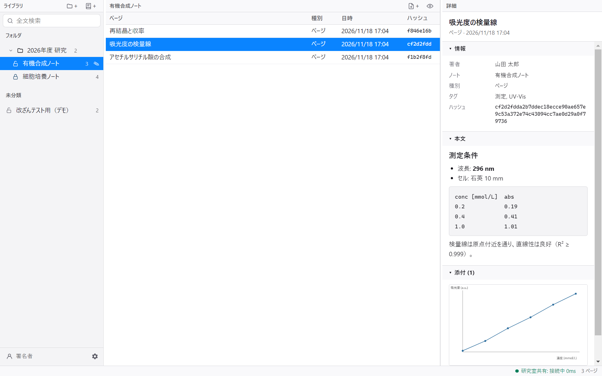
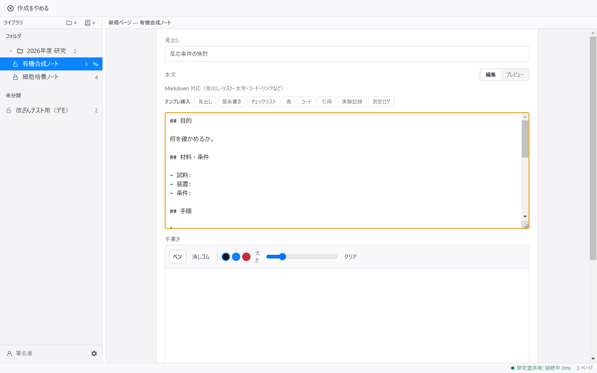
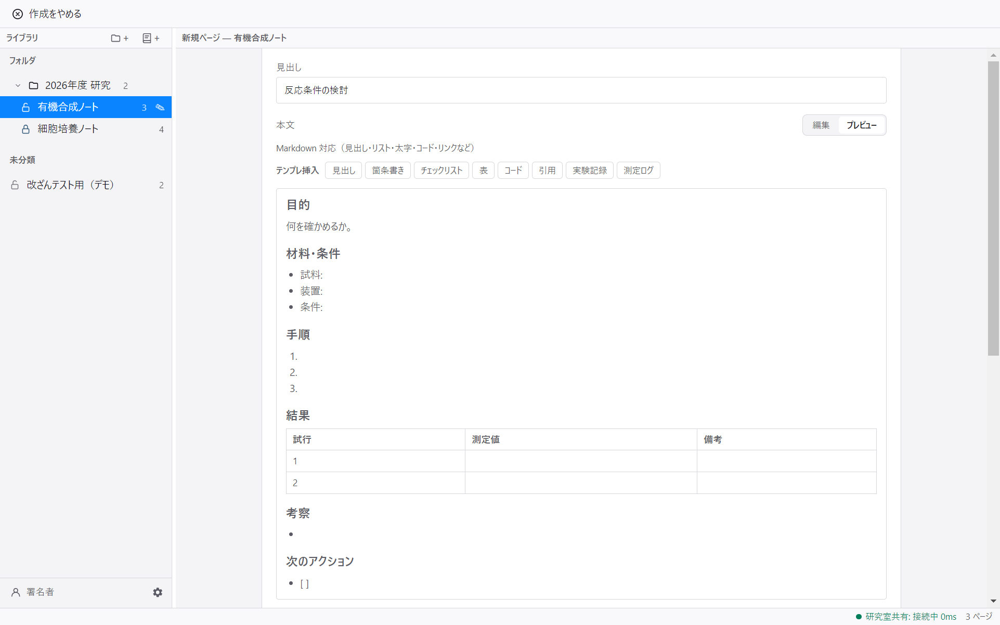
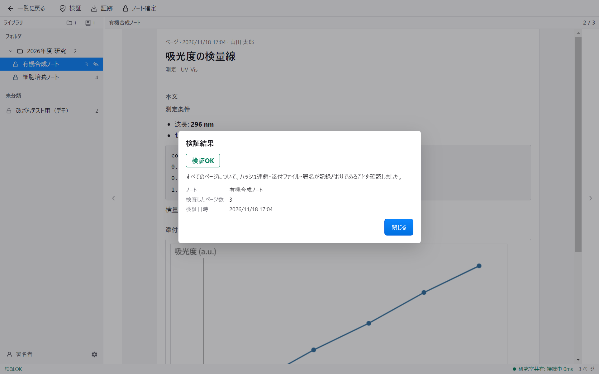
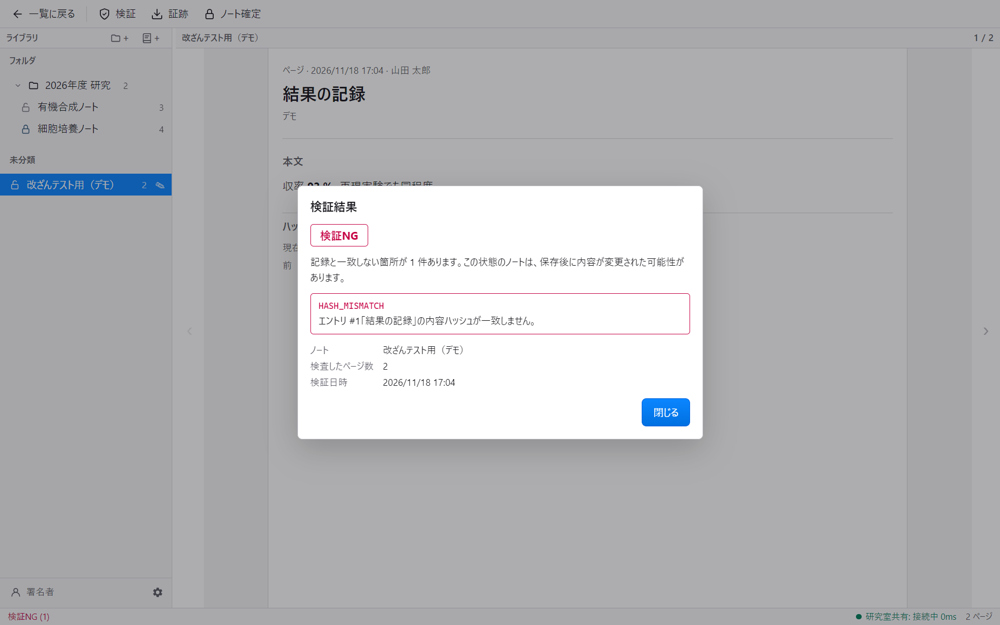
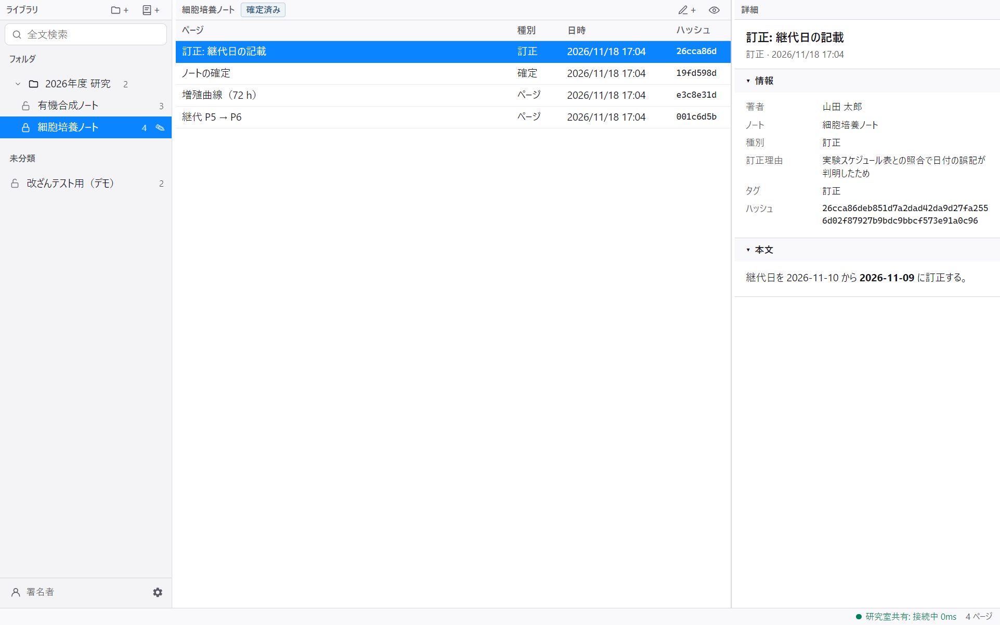
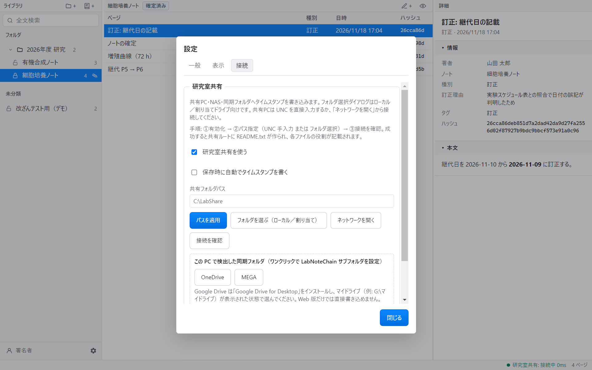
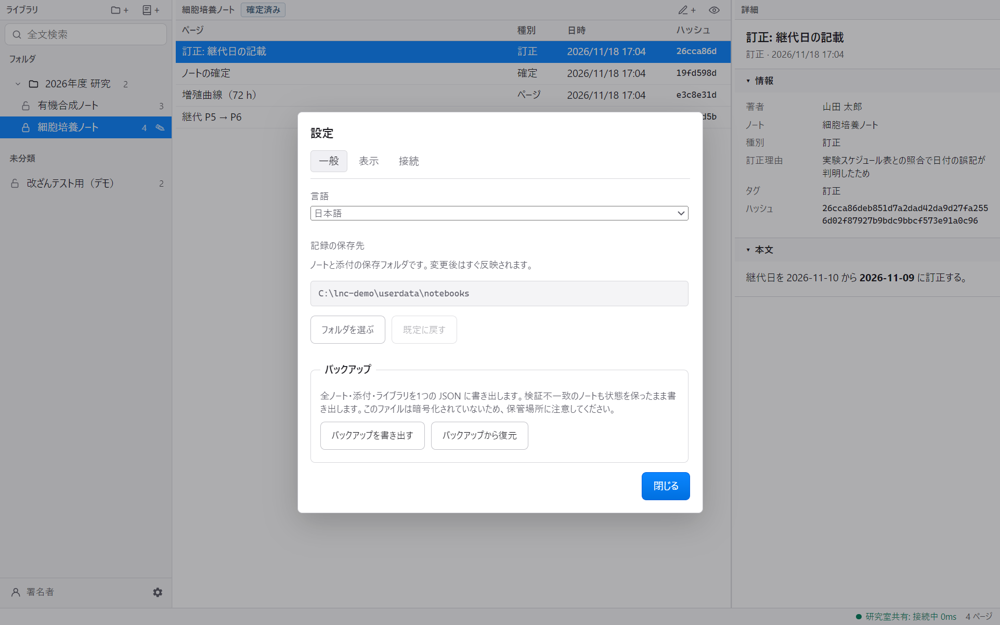
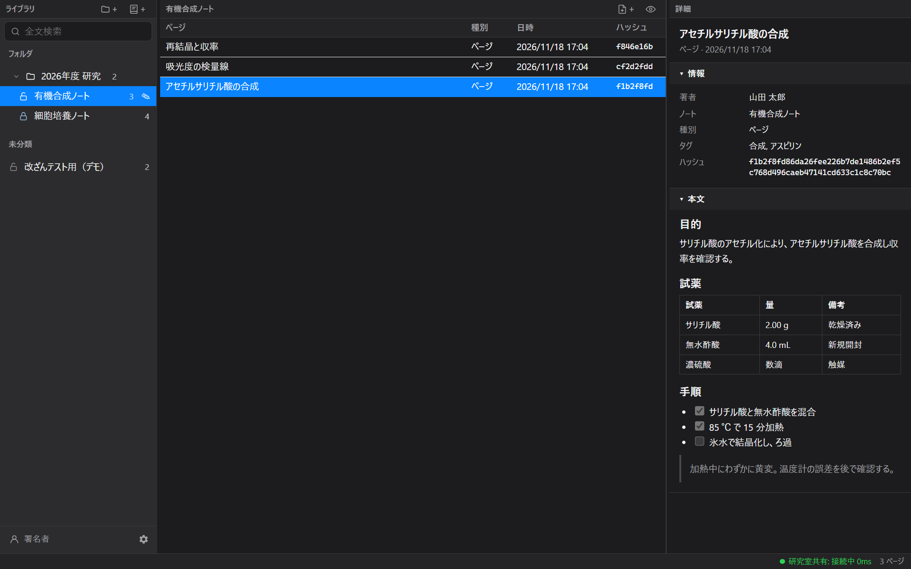
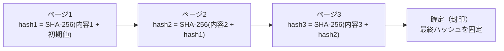

# LabNoteChain

**改ざんを検知できる研究ノート。** Windows 向け・ローカル完結・無料のオープンソースソフトウェアです。

研究記録（実験ノート）を書き、あとから「書き換えられていないか」をいつでも検証できます。クラウドへの送信はありません。データはすべて自分の PC（または自分で指定した共有フォルダ）に保存されます。



## 特長

- **ハッシュ連鎖による改ざん検知** — 各ページを SHA-256 で連鎖させて記録します。過去のページや添付ファイルを書き換える・消す・並べ替えると、検証で見つかります。
- **ノートの確定（封印）と訂正の履歴** — 確定したノートには通常のページを足せません。誤りは「訂正ページ」として、理由つきで履歴に残します。
- **電子署名（任意）** — Windows Hello（顔・指紋・PIN）で本人確認し、ページに Ed25519 署名を付けられます。
- **Markdown で執筆** — 見出し・表・チェックリスト・コードなどに対応。表やコードブロック、実験記録・測定ログなどのテンプレートをワンクリックで挿入できます。手書きスケッチも使えます。
- **添付ファイルをコピーして保存** — 元ファイルを消しても、ノートの記録は変わりません。添付の SHA-256 もハッシュ連鎖に含まれます。
- **研究室の共有フォルダに時刻記録を出力** — ページ保存時に、ハッシュと時刻を共有 PC・NAS・同期フォルダ（OneDrive、MEGA など）へ書き出せます。フォルダ名はノート名・ページ名と対応します。
- **整理と検索** — フォルダ分け、全文検索、ノート名の変更、ライト／ダークテーマ、日本語／英語の表示切り替え。
- **バックアップと復元** — 全ノート・添付・フォルダ構成を 1 つの JSON に書き出し、別の PC でも検証つきで復元できます。
- **証跡パッケージ** — 検証結果つきの JSON を書き出し、第三者へ提示できます。

## ダウンロード

最新版は [Releases](https://github.com/yoshifordev-cyber/LabNoteChain/releases/latest) から入手できます。Windows 10 / 11（64 ビット）向けのインストーラーです。

1. `LabNoteChain-Setup-<バージョン>.exe` をダウンロードして実行します。
2. 配布ファイルの整合性は、同じページの `SHA256SUMS.txt` と照合できます。

   ```powershell
   Get-FileHash .\LabNoteChain-Setup-0.1.0.exe -Algorithm SHA256
   ```

> **v0.1.0 は、コード署名がありません。** 初回の実行時に Windows SmartScreen が「Windows によって PC が保護されました」と表示することがあります。その場合は「詳細情報」→「実行」を選んでください。署名の取り組みは [Code signing policy](docs/code-signing-policy.md) に記載しています。

## 画面の紹介

### Markdown で書く

テンプレートを挿入して書き、プレビューで見え方を確認できます。

| 編集 | プレビュー |
|---|---|
|  |  |

### 検証する

ノートの「検証」で、ハッシュ連鎖・添付ファイル・署名が記録どおりかを確認します。



保存後にページの内容が書き換えられると、どのページが不整合かを示して検証NGになります。次の画面は、本文の「62 %」を「92 %」に書き換えたデモです。



### ノートを確定し、訂正を履歴に残す

確定したノートには鍵のアイコンが付きます。確定後の誤りは、理由つきの「訂正ページ」で追記します。元のページは消えません。



### 研究室の共有フォルダへ時刻を記録する

共有 PC・NAS・同期フォルダを指定すると、ページを保存するたびにハッシュと時刻が書き出されます。「接続を確認」で到達性を確かめられます。この PC で見つかった同期フォルダは、ワンクリックで選べます。



### 設定とバックアップ



### ダークテーマ



## 仕組み

各ページには、本文・添付・ひとつ前のページのハッシュを材料にした SHA-256 値が付きます。



途中のページを 1 文字でも変えると、そのページの値と以降の連鎖がすべて合わなくなります。検証はこの連鎖、添付ファイルの SHA-256、署名、確定時の値を順に確かめます。

## できること・できないこと

LabNoteChain は「改ざんを**防止**する」ものではなく、「改ざんを**検知**する」ものです。誤解のないよう、範囲を正直に書きます。

**できること**
- 保存後のページ・添付ファイル・並びの変更や削除を、検証で検知する。
- 確定後の変更を、通常ページの追加ではなく「訂正」として履歴に残す。
- 署名により、登録した署名者の鍵で付与された記録であることを示す（署名鍵はこの PC に保存され、バックアップには含まれません）。
- 共有フォルダにもハッシュと時刻を残し、記録の突き合わせの根拠にする。

**できないこと（現在の版）**
- **第三者機関による時刻証明（RFC 3161 などのタイムスタンプ）には未対応です。** 記録される時刻は、お使いの PC の時計です。法的な証拠力を保証するものではありません。
- ノートの全体を、権限を持つ人が最初から矛盾なく作り直した場合は、ノート単体では検知できません。共有フォルダの記録や署名との突き合わせが必要です（突き合わせ機能は今後の予定です）。
- データやバックアップファイルは**暗号化されていません**。保管場所の管理は利用者が行ってください。

## 使い方（かんたん）

1. 左の「ライブラリ」見出しの右にある、ノートのアイコンの「＋」で**新規ノート**を作ります。
2. ノートを選び、ページ一覧の「＋」で**新規ページ**を書きます。Markdown とテンプレートが使えます。
3. 区切りのよいところで「検証」を押し、結果を確認します。
4. 記録が完了したら「ノート確定」で封印します。以降の修正は「訂正ページ」で行います。
5. 設定 → 一般 で、記録の保存先の確認とバックアップができます。設定 → 接続 で、研究室共有を設定できます。

## データの保存先

設定 → 一般 の「記録の保存先」に表示されます。既定では、Windows のユーザーデータ領域（`%APPDATA%` 配下）に保存します。保存先は変更できます。アンインストールしてもノートは削除されません。

## ソースからビルドする

Node.js 20 以降が必要です（動作確認は Node.js 24）。

```powershell
git clone https://github.com/yoshifordev-cyber/LabNoteChain.git
cd LabNoteChain
npm install
npm run dev        # 開発モードで起動
npm run typecheck  # 型チェック
npm run dist       # Windows インストーラーを作成（release/ に出力）
```

README などの画面画像は、デモデータを使って `npm run build` の後に `npx electron scripts/capture-screenshots.cjs` で再生成できます。

## ポリシー

- [Code signing policy（コード署名ポリシー）](docs/code-signing-policy.md)
- [Privacy policy（プライバシーポリシー）](docs/privacy-policy.md)

## ライセンス

[GNU General Public License v3.0 only](LICENSE) で提供します。ソースコードの改変・再配布は、同じライセンスの条件で自由に行えます。

## 今後の予定

確約ではありません。優先度は利用者の声で変わります。

- 初回起動ガイドと日本語マニュアル
- 自動アップデート
- データの暗号化
- 検証だけを行う単体ツール、共有フォルダとの突き合わせ
- 印刷・PDF 出力（検証結果と QR コードつき）
- 外部タイムスタンプ（認定タイムスタンプ事業者の利用）

不具合や要望は [Issues](https://github.com/yoshifordev-cyber/LabNoteChain/issues) にお寄せください。

---

## English summary

**LabNoteChain** is a free, open-source (GPL-3.0-only), local-only lab notebook for Windows that makes tampering *detectable*. Each page is chained with SHA-256 (including attachments); you can seal a notebook and add corrections with reasons; optional Ed25519 signatures use Windows Hello; and per-page hashes and times can be written to a shared or synced folder.

- **Download:** [Releases](https://github.com/yoshifordev-cyber/LabNoteChain/releases/latest) (Windows 10/11, x64). v0.1.0 is **not code-signed yet**, so SmartScreen may warn. See the [code signing policy](docs/code-signing-policy.md).
- **Privacy:** the app does not send any data over the network. See the [privacy policy](docs/privacy-policy.md).
- **Limits:** it detects changes; it does not prevent them. Times come from your PC clock; third-party (RFC 3161) timestamping is not implemented yet. Data and backups are not encrypted.
- **Build:** `npm install`, then `npm run dist` (Node.js 20 or later).
